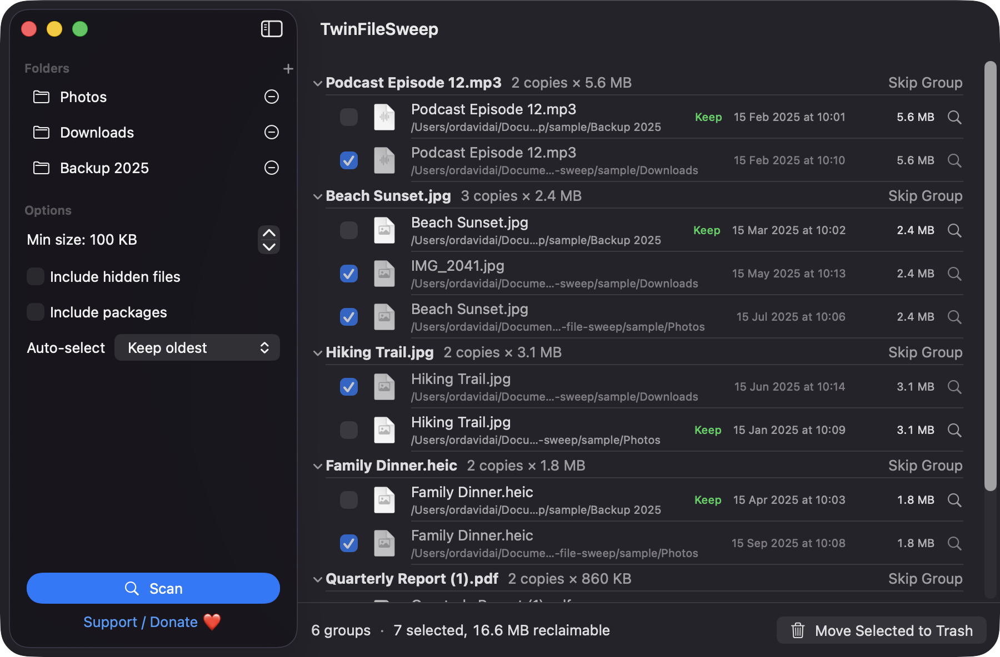
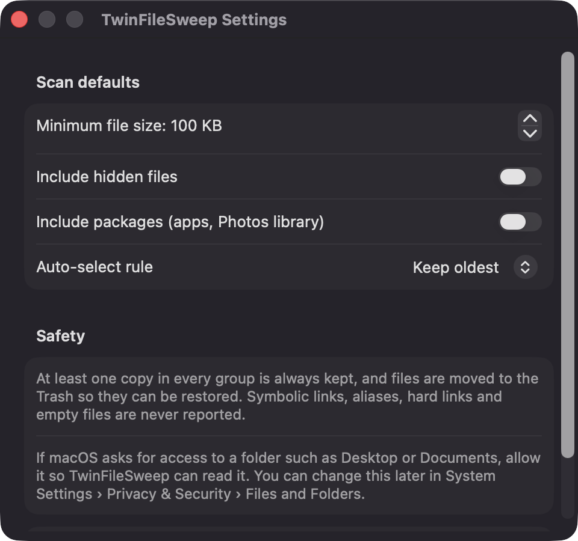
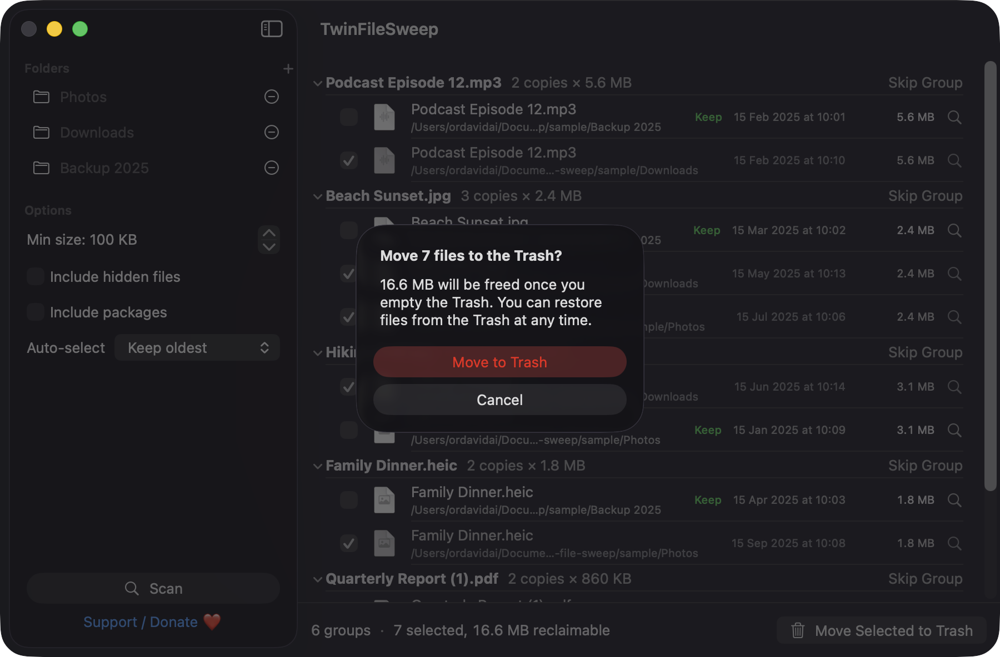

# TwinFileSweep

**🌐 Website:** [turhe123.github.io/twin-file-sweep](https://turhe123.github.io/twin-file-sweep/)

Find exact duplicate files in chosen folders and trash the extra copies safely with a clear keep-one preview.


## Why

TwinFileSweep is a free, open-source, 100% native, backend-free alternative to paid utilities in the *Files & Conversion* category. It was inspired by tools such as Gemini 2 ($19.95 one-time), which popularised the "show me the duplicates, let me remove the extras" workflow. TwinFileSweep covers one job, exact duplicates, and does it entirely on your Mac.

## Features

- **Exact duplicates only.** Files are grouped by size, then by a SHA-256 hash of the first and last 64 KB, then by a full streaming SHA-256 (1 MB chunks, CryptoKit). Only plausible candidates are read in full.
- **Parallel hashing** with bounded concurrency (2–8 workers, based on your CPU count), with a progress bar showing the current phase (Sizing, Sampling, Hashing) and a Cancel button.
- **Folders by drag and drop or ⌘O.** The folder list is remembered between launches.
- **Scan options:** minimum file size (default 100 KB, adjustable in 100 KB steps), include hidden files, include packages.
- **Keep-one preview.** Each group is expandable and lists every copy with checkbox, icon, name, folder, modified date and size. Copies marked for removal are dimmed. The copy you keep is labelled "Keep".
- **Auto-select rules:** keep oldest, keep newest, keep shortest path, or keep the one in the first folder added. Changing the rule re-applies it immediately.
- **Safety rule enforced in the model:** at least one copy in every group always stays unselected, and the Trash button stays disabled otherwise.
- **Recoverable.** Selected files go to the Trash via `FileManager.trashItem`, after a confirmation that shows the space that will be freed.
- **Footer totals:** group count, selected count and reclaimable size.
- **Per-file Reveal in Finder** and per-group **Skip Group**.
- **Edge cases handled:** symbolic links and aliases are skipped, hard links to the same file count as one file, empty files are ignored, and files that change or vanish mid-scan are dropped. Unreadable files are listed in a collapsible Warnings section.
- **Package warning.** Adding an app bundle or a Photos library shows a caution, and package contents are skipped unless you enable "Include packages".
- **Settings window** (⌘,) for default scan options.
- **Keyboard:** ⌘O add folder, ⌘↩ scan, ⌫ move selection to Trash.
- A friendly "No duplicates found" state when a scan comes up clean.

Not included: similar-image or fuzzy matching. Rows show standard file icons, not Quick Look thumbnails.

## Screenshots

<p align="center"></p>

<p align="center"><em>Scan results group exact duplicates across three folders, with the oldest copy marked Keep and the extras pre-selected for removal, plus a 16.6 MB reclaimable total.</em></p>

<p align="center"></p>

<p align="center"><em>Settings let you set default scan options: minimum file size, hidden files, packages, and the auto-select rule.</em></p>

<p align="center"></p>

<p align="center"><em>Before anything is removed, a confirmation shows how many files go to the Trash and how much space will be freed.</em></p>

## Install

1. Download `TwinFileSweep-macOS.zip` from the [latest release](https://github.com/turhe123/twin-file-sweep/releases/latest).
2. Unzip it and move `TwinFileSweep.app` to `/Applications`.
3. The app is open source and not notarized, so clear the quarantine flag:

   ```bash
   xattr -cr /Applications/TwinFileSweep.app
   ```

4. Right-click the app and choose **Open** the first time.

## Build from source

Requires macOS 14+ and Xcode with Swift 5.9+.

```bash
brew install xcodegen
xcodegen generate
xcodebuild -project TwinFileSweep.xcodeproj -scheme TwinFileSweep -configuration Release -derivedDataPath ./build build
```

The app is produced at `build/Build/Products/Release/TwinFileSweep.app`.

## Permissions

TwinFileSweep does not request Accessibility, Screen Recording, Microphone, Camera or network access, and it has no special entitlements. The app is not sandboxed and only reads folders you add via the open panel or drag and drop.

- **Files and Folders:** if you add a protected location such as Desktop, Documents or Downloads, macOS shows its standard access prompt. Allow it so the app can read that folder. You can change this later in System Settings › Privacy & Security › Files and Folders.

## Built with AI

TwinFileSweep was written by [Claude Code](https://claude.com/claude-code) inside an automated pipeline, from a plain-English spec. No code, binaries or assets from any commercial app were used; it is a clean-room reimplementation of a feature set, not a copy.

What that means in practice:

- The full source is in this repo under the MIT license. Read it before you run it.
- No network calls, no analytics, no third-party dependencies. Only Apple frameworks.
- Ad-hoc signed and not notarized, which is why Gatekeeper warns on first launch.
- It has had less human review than a hand-written app. Bug reports and pull requests are welcome.

## Support ❤️

If TwinFileSweep saved you some disk space, you can support its development:

[Support Or (Leo) Davidai ❤️](https://ko-fi.com/leodavidai)

The app also has a "Support / Donate ❤️" button in the sidebar, Settings and the Help menu.

## License

MIT © Or Davidai Bachar
